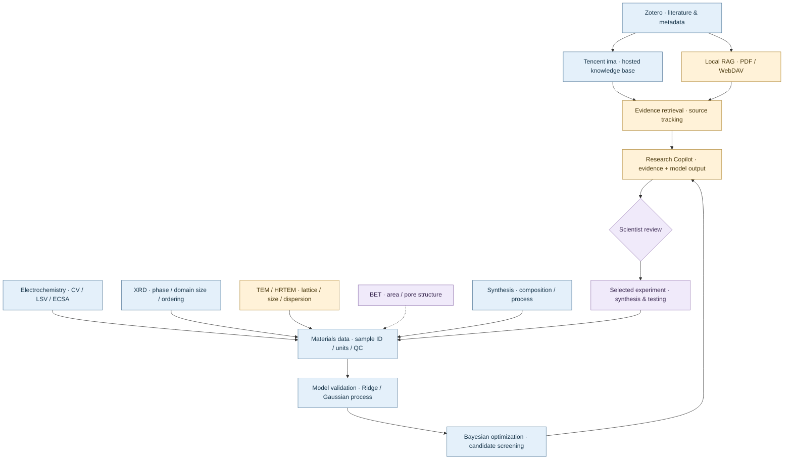

# AI4M/S for Electrocatalyst R&D

Validate models on electrocatalyst synthesis data and plan experiments with **Bayesian optimization**. The planner uses a Gaussian-process surrogate with uncertainty estimates, constraint forecasts and a reproducible record. Planner **v1.1.0**.

[IrOx OER case study](examples/irox_screening/README.md) · [Verified synthetic closed loop](docs/verified-closed-loop.md) · [Configuration](assets/config.yaml) · [PtCo synthetic example](assets/config_ptco_example.yaml) · [Change log](CHANGELOG.md)

## Materials Research Copilot — AI4M/S workflow

A modular research architecture connecting scientific literature, structured experimental evidence, characterization software and uncertainty-aware experiment planning.



| Layer | Repository / capability | Status |
| --- | --- | --- |
| Literature ingestion | [Zotero Scholar Bridge](https://github.com/ANDYPENG09/zotero-scholar-bridge), [Zotero ima sync](https://github.com/ANDYPENG09/zotero-ima-sync) | Existing tools |
| Literature retrieval | Tencent ima API adapter and local PDF/WebDAV retrieval | Prototype in [PR #2](https://github.com/ANDYPENG09/bayesian-optimization-electrocatalyst/pull/2); live authentication and retrieval not yet verified |
| Scientific analysis | [Electrochemistry analyzer](https://github.com/ANDYPENG09/PEMFC-Electrocatalyst-Activity-Analyzer), [XRD toolkit](https://github.com/ANDYPENG09/xrd-toolkit) | Existing tools; automated XRD integration planned |
| TEM / HRTEM | [TNLA v0.1](https://github.com/ANDYPENG09/bayesian-optimization-electrocatalyst/tree/main/research_tools/tem) · lattice spacing, particle sizing, geometric dispersion | Local prototype; real TIFF and UI validation pending |
| BET / porosimetry | [Quantachrome adsorption analysis](https://github.com/ANDYPENG09/bayesian-optimization-electrocatalyst/tree/main/research_tools/bet) · planned, no calculation yet | Placeholder |
| Materials informatics | Structured experiment CSV, sample-ID joins, QC, units and provenance | Existing CSV workflow; unified database planned |
| Machine learning & experiment planning | Ridge / Matérn GP, batch validation, constrained Bayesian optimization | Existing planner; real IrOx retrospective validation and synthetic closed-loop demonstration |
| Research Copilot | Combine literature evidence with independent model reports | Prototype; autonomous orchestration and prospective experimental validation planned |

**Research principle:** evidence-grounded hypotheses and model predictions are distinct. Experimental decisions remain subject to scientist review. This diagram describes the integration architecture, not a claim of a fully deployed autonomous laboratory. No private literature, credentials or proprietary raw experimental data are included.

## Start with model validation

The [IrOx OER case](examples/irox_screening/README.md) compares a ridge baseline and a Matérn GP on 20 independent synthesis batches. It uses 65 annotated LSV scans, including commercial controls, to estimate repeatability and define the first-scan response. Within the 350–500 °C historical subset, first-scan leave-one-batch-out RMSE was **16.8 mV for ridge** and **24.3 mV for the GP**. Use this result for retrospective recipe screening. Confirm predictive accuracy and uncertainty before using acquisition scores to justify new recipes.

```bash
python examples/irox_screening/benchmark.py --output irox_output/demo
```

The command runs the seeded synthetic example. The [notebook](examples/irox_screening/irox_screening.ipynb) plots held-out errors and accepts the same local input schema as the CLI.

## Bayesian optimization quick start

```bash
python -m venv .venv
# Windows: .venv\Scripts\activate
# macOS/Linux: source .venv/bin/activate
pip install -r requirements.txt
python scripts/bo_pipeline.py --data assets/experiment_template.csv --config assets/config.yaml --batch 3 --seed 0 --out next_experiment.json
```

Execute a chosen experiment, append its measured results to the input CSV, then rerun. The bundled datasets are **synthetic**, not proprietary experimental data. Sparse/high-dimensional datasets produce a review flag; predictions are not independently validated by those examples.

## Implemented behavior

| Capability | Method and limitation |
|---|---|
| Objective model | Matérn 5/2 with per-feature length scales; marginal-likelihood hyperparameter optimization, not MAP with a hyperparameter prior |
| Inputs | Real / integer / categorical; normalized numeric and one-hot categorical features; integers/categories survive JSON export |
| Acquisition | EI, PI, UCB in maximization direction; candidate-pool optimization, not a global optimum guarantee |
| Objectives | Direction-adjusted weighted sum with explicit positive scales; no Pareto-front search or EHVI |
| Known input constraints | Exact candidate filtering when the constrained field is a decision variable |
| Measured outcome constraints | One GP per outcome; product of marginal feasibility probabilities under an independence approximation |
| Batch | Fixed-posterior greedy separation; no repeated candidate or historical/pending design; not joint q-EI |
| Uncertainty | Unclipped conditional GP mean/std and 95% band on weighted utility; fitting warnings are exported |
| Stopping | Small recent gain AND low modeled EI, with sparse-data/model-warning checks; a heuristic, not proof of global convergence |
| QC | If `qc_status` exists, only `Good` is accepted by default; `Invalid` can never be enabled |

A recommendation that satisfies an **outcome probability threshold** is still a forecast. It does not guarantee particle size, durability or other measured outcomes. If no untested candidate meets the threshold, the planner writes no new recommendation and explains what needs review. With no measured feasible design, it labels the run `feasibility_search` and ranks eligible candidates by forecast feasibility.

## Configure recommendation rules

```yaml
recommendation:
  n_candidates: 4096
  min_feasibility_probability: 0.8
  history_distance: 0.000001
  batch_distance: 0.02
pending_experiments:
  # - {T_C: 700, t_h: 2, pH: 1, E_V: 1.5, m_cat: 0.2, x_M1: 0.5}
```

Distances use Euclidean distance in normalized/encoded input space. This is a numerical separation rule; choose variables/discrete levels matching experimental resolution. Historical designs are excluded even when their QC rejects them from model fitting. Add already scheduled experiments to `pending_experiments`; unchanged baselines need not be scheduled again.

Objective values are finite complete data. Missing objective/constraint values on accepted rows produce an error, not an inferred zero. Constraints use `le` or `ge`; their thresholds retain the corresponding CSV units. The displayed predicted utility combines the configured scales/weights, not a raw MA/ECSA value.

## Outputs and compatibility

`next_experiment.json` keeps `next_experiment`, prediction fields, `convergence` and `trace`. The legacy `batch` array remains the q−1 additional points. New `recommendations` contains all q points with individual predictions/constraint reports; `schema_version` is `1.1.0`. `trace.json` and the embedded trace include completed spans.

```bash
python scripts/bo_pipeline.py --acq UCB --beta 2 --batch 3 --seed 7
python scripts/run_synthetic_closed_loop.py --output demo_output
python -m unittest discover -s tests -v
```

### Import electrochemistry results

```bash
python scripts/import_analyzer_results.py --design design.csv --results results.csv --out joined.csv
python scripts/bo_pipeline.py --data joined.csv --config campaign.yaml
```

The importer joins [PEMFC analyzer](https://github.com/ANDYPENG09/PEMFC-Electrocatalyst-Activity-Analyzer) exports to your synthesis-design CSV by unique `sample_id`. It requires the same ID set and rejects ambiguous columns. Preserve the analyzer's metric units and QC. XRD empirical indices must remain distinct from calibrated long-range `S` values.

## Validation

Tests cover reproducible unique batches, input/outcome constraints, integer/category serialization, pending exclusions, QC, invalid data, exhausted spaces, acquisition limits, traces and stopping logic. A synthetic closed-loop example and the bundled PtCo example are exercised in CI. No real catalyst improvement or model calibration is claimed by these tests.

Theory: Roman Garnett, *Bayesian Optimization* (Cambridge University Press, 2023). [scikit-learn GP documentation](https://scikit-learn.org/stable/modules/gaussian_process.html). [MIT License](LICENSE).
