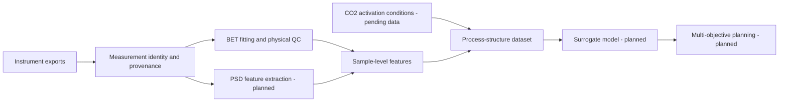

# Porous Carbon Engineering — AI4M/S

**Physics-aware porosimetry, scientific data quality and CO₂ activation optimization**

A materials-informatics project for porous carbon research. The goal is to connect reproducible gas adsorption analysis with synthesis and activation conditions, then explore process–structure relationships and uncertainty-aware experimental planning.

**Status: initial Python prototype.** The experimental dataset is not included. Process modeling, raw vendor import, PSD analysis and Bayesian optimization are future milestones, not demonstrated results.

## Research workflow



## Implemented in this prototype

- Standardized adsorption/desorption CSV ingestion, separated by measurement ID.
- Ordinary least-squares BET fit using actual adsorption points in P/P₀ = 0.05–0.30; no interpolation.
- Slope, intercept, monolayer uptake, area, C constant and R².
- Screening for nonphysical parameters, C and R² thresholds, monotonic V(1−P/P₀), and calculated monolayer pressure within the selected interval. These checks are preliminary, not a complete automated Rouquerol selection algorithm.
- Exact measured P/P₀ = 0.95 liquid volume and 4V/S equivalent diameter; missing exact points stay null.
- Synthetic analytic and failure-mode unit tests (not yet verified in CI).

## Run

Python 3.10+; no external dependencies.

```bash
cd research_tools/bet
python bet_analysis.py path/to/isotherm.csv
python -m unittest -v test_bet_analysis.py
```

Input columns: `measurement_id,branch,p_rel,v_cm3_g_stp`. Branch values: `adsorption` or `desorption`. Relative pressure is dimensionless; uptake is cm³(STP)/g. Use normalized, verified exports only. Constants are specific to the declared nitrogen/STP convention. A fit with a nonphysical intercept or C is invalid even if the numerical area is reported for diagnosis.

## Data model and future development

| Entity | Key fields |
|---|---|
| Material | sample_id, batch_id, precursor, carbonization history |
| Activation run | run_id, parent_sample_id, temperature, duration, CO₂ flow and concentration, ramp, initial/final mass, burn-off |
| Measurement | measurement_id, sample_id, instrument, degas conditions, mass, source_file, file hash, method, units |
| Isotherm | measurement_id, branch, step, actual p_rel, uptake |
| PSD | measurement_id, model, branch, pore geometry, width or diameter, cumulative/incremental volume and area, distribution basis |
| QC | measurement_id, rule, status, reason, source |
| Features | sample_id, measurement_id, fit method, BET area, C, R², pore volume, 4V/S equivalent diameter, model-specific pore fractions |

Do not conflate DFT pore width with BJH pore diameter; preserve kernel and distribution basis. NLDFT/QSDFT adsorption kernels are distinct from electronic-structure DFT. Do not reconstruct PSD from BET area alone. Do not treat repeated measurements as independent materials. A fitted scaling factor is not proof of a mass-entry error.

## Roadmap

- [x] Standardized BET computation and initial physical screening
- [x] Synthetic test cases authored
- [ ] Execute automated tests and integrate CI
- [ ] Instrument-specific import, source identity and cross-file reconciliation
- [ ] PSD parsing, cumulative feature extraction and integration checks
- [ ] Matched-step anomaly detection and residual analysis
- [ ] CO₂ activation experimental dataset and burn-off descriptors
- [ ] Process–structure modeling with group-aware validation
- [ ] Multi-objective optimization under yield and pore-structure constraints

## Data policy

No proprietary raw files, actual sample identifiers, confidential process parameters or experimental results are distributed with this prototype. Only synthetic or expressly authorized public data may be committed. Real experimental datasets remain external. This is research software, not an instrument-certified analysis package.
